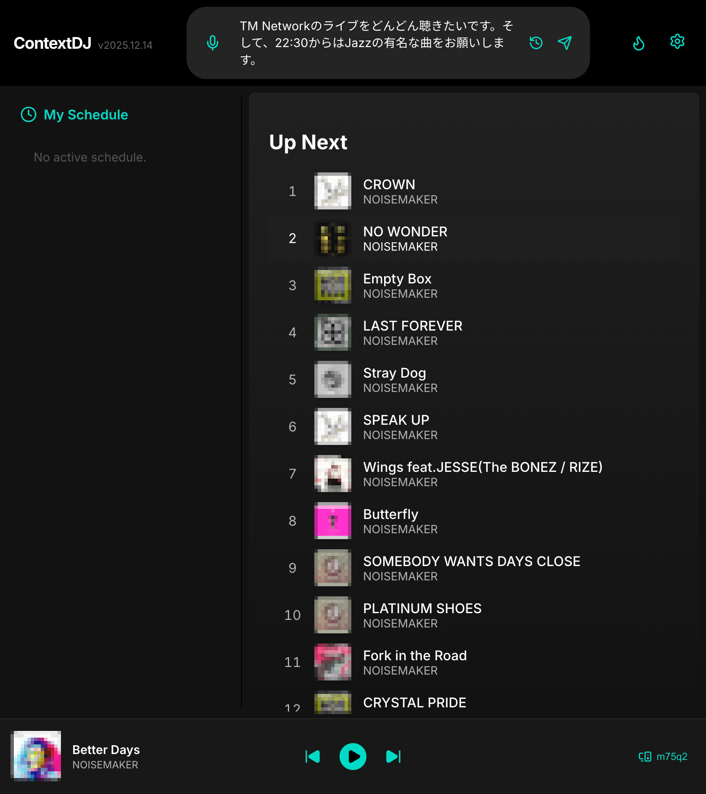
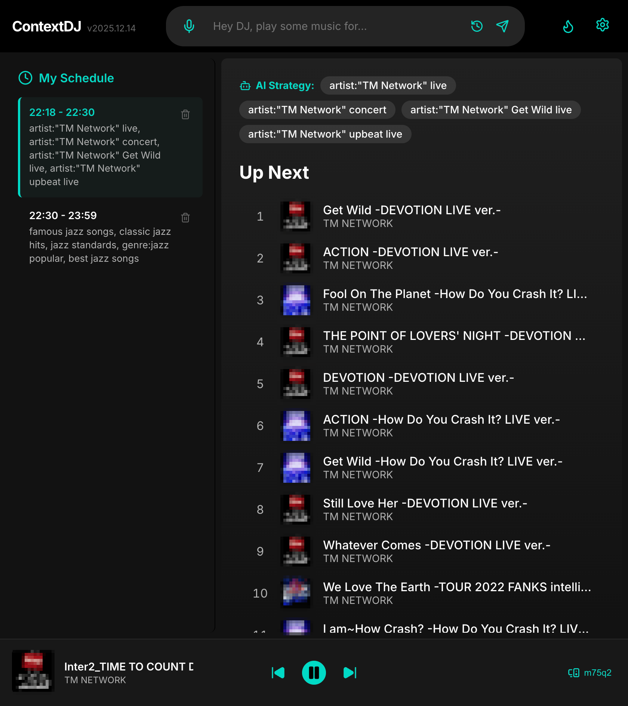
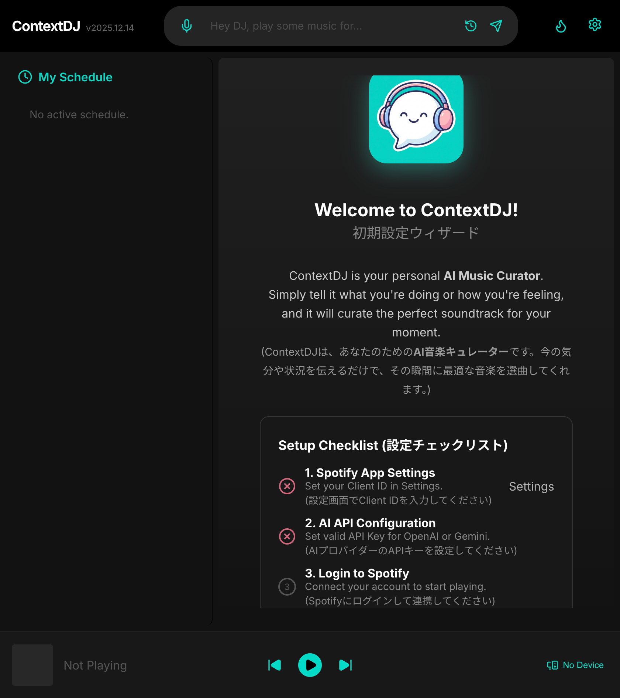
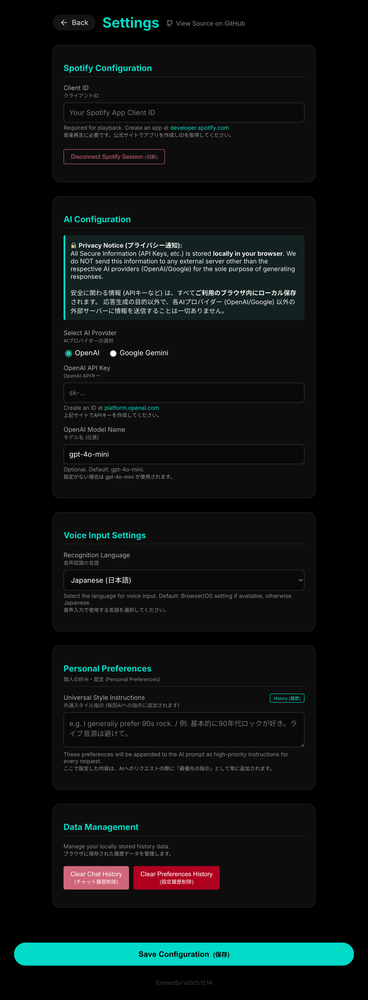

[ Languages: **English** | [日本語](README.ja.md) (Japanese) ]

# ContextDJ


**ContextDJ** - AI Music Curator. It turns your vague requests (e.g., "Play music that fits the mood of a walk by the sea. I want to listen to piano jazz from 11 PM.") into a perfectly curated scheduling of tracks.

Unlike standard shuffle or playlists, ContextDJ builds a **context-aware schedule**, mimicking a radio DJ that understands the flow of time and mood.

🌐 **Try it now:** [contextdj.remoteroom.jp](https://contextdj.remoteroom.jp/)



*(Screenshot: Inputting a request)*


*(Screenshot: Main player interface with AI-generated queue)*

## ✨ Key Features

- **🎼 Smart Sequencing (Story Arc / 起承転結)**: Evaluates candidate tracks by energy (1–10), estimated BPM, and set role (`Intro` → `Build` → `Peak` → `Outro`), automatically arranging every queue into a cohesive 4-stage DJ progression rather than a random shuffle.
- **⚓ Anchor Tracks & Multi-Axis AI Filtering**: Seeds each schedule block with iconic "Anchor Tracks" and verifies Spotify search candidates using track, artist, and **album** context—filtering out generic commercial/advertising BGM, karaoke, and music box covers while strictly prioritizing explicitly requested artists.
- **✨ DJ Insight & Track Notes**: Real-time visibility into the AI's creative "train of thought," plus toggleable per-track **DJ Notes** (Quote icon) showing **Vibe Tags** (e.g., `#夕暮れチル`), stage/energy badges, and one-sentence selection reasons.
- **📸 Context Vision & 🎤 Voice Input**: Use your camera to "show" the DJ your environment so the AI can translate visual mood and lighting into soundtracks, or use multi-language **Voice Input** to speak requests hands-free.
- **♻️ Context Recall & Personal Preferences**: Click archived schedule items to instantly re-summon and remix past moods, or set persistent **Personal Preferences** (universal style instructions) in Settings that are automatically applied to every request.
- **🥣 Auto-Refill (Okawari) & Resilient Sync**: An intelligent, endless loop that automatically generates new schedule items and refills the queue before the music stops, backed by Spotify playback convergence sync, transition guards, and background-optimized polling.
- **🖥️ Terminal CUI / TUI Dashboard**: Built-in Ink-based terminal UI for controlling playback, inspecting live progress, Vibe/Stage metadata, and DJ thoughts, and submitting requests directly from your terminal or `tmux`.
- **🔒 Privacy First (BYOK)**: Direct client-to-service communication. Your API keys (Spotify, OpenAI, Gemini) never leave your browser or local CLI config.

## 🚀 Getting Started

### Prerequisites

To use ContextDJ (even the hosted version), you need:

1.  **Spotify Premium Account**: Required for the Web API playback controls.
2.  **Spotify Client ID**: Create an application in the [Spotify Developer Dashboard](https://developer.spotify.com/dashboard/applications).
    - **APIs used**: **Make sure to check and enable `Web API`** (⚠️ Omitting this will cause track search and playback to fail with `QUOTA_EXCEEDED` or authorization errors).
    - **Redirect URIs**: Add the appropriate URI(s) based on your usage (you can register multiple URIs and share a single Client ID between Web and CLI):
        - Web Hosted: `https://contextdj.remoteroom.jp/`
        - CLI / Terminal: `http://127.0.0.1:8888/callback`
        - Local Web Dev: `http://127.0.0.1:3000/`
3.  **AI API Key**: An API key from either [OpenAI](https://platform.openai.com) (default model: `gpt-5.4-mini`) or [Google AI Studio](https://aistudio.google.com/) (default model: `gemini-flash-latest`).

### Setup Guide

1.  Go to [ContextDJ](https://contextdj.remoteroom.jp/). 
2.  Click the **Settings (⚙️)** icon in the top right. 
3.  Enter your **Spotify Client ID**.
4.  Select your **AI Provider** (OpenAI or Google Gemini) and enter your **AI API Key** (you can also customize the model name, Voice Input language, and Personal Preferences).
5.  Click **Save Configuration**.
6.  Return to the home page, type (or speak) a prompt (e.g., *"Bright jazz for the afternoon, and winter a cappella for the night"*), and hit Send!

## 🛠️ Development

If you want to run ContextDJ locally or contribute:

1.  **Clone the repository**
    ```bash
    git clone https://github.com/mah-jp/context-dj.git
    cd context-dj
    ```

2.  **Install dependencies**
    ```bash
    yarn install
    ```

3.  **Run the development server**
    ```bash
    yarn dev
    ```

4.  Open [http://127.0.0.1:3000](http://127.0.0.1:3000) with your browser.

5.  **Run tests and linter**
    ```bash
    yarn test
    yarn lint
    ```

## 🖥️ CLI / Terminal Version

A terminal-native CUI (TUI) dashboard is built into ContextDJ, allowing you to control playback and interact with the AI curator directly from your terminal (ideal for `tmux` or headless setups). It provides real-time visualization of the active schedule, anchor tracks, currently playing track with progress bar, AI-curated metadata (`Vibe`, `Energy`, `Stage`, `Reason`), DJ thoughts, and an interactive request prompt.

### Launching

```bash
# Install dependencies (first time only)
yarn install

# Launch interactive TUI dashboard
yarn cli

# Launch and submit an initial music request directly
yarn cli "Chill beats for late night coding"

# Run interactive setup wizard
yarn cli setup

# Show configuration file path or help
yarn cli --config
yarn cli --help
```

### Initial Authentication (Copy-Paste Method)
1. On first run, `yarn cli` displays an authorization URL in your terminal.
2. Open the URL in your local browser and approve the request.
3. Copy the redirected URL (`http://127.0.0.1:8888/callback?code=...`) from your browser's address bar and paste it into the terminal.
4. The obtained `refresh_token` is saved in `~/.config/context-dj/config.json` and refreshed silently in the background.

> [!IMPORTANT]
> **Spotify Client ID Tips**:
> - Ensure **`Web API` is enabled** when creating your Spotify App (omitting it prevents track searches and playback controls from working).
> - You can reuse your existing Web Client ID by simply adding `http://127.0.0.1:8888/callback` to the Redirect URIs under your app's Settings.

### CUI Controls

* **Request Input**:
  * `Enter`: Submit music request to trigger AI schedule curation and playback.
  * `↑` / `↓`: **Navigate request history**. Automatically restores unsaved draft inputs when returning to the bottom (persisted to `~/.config/context-dj/history.json`).
* **Quick Playback Controls (when input prompt is empty)**:
  * `Space`: Play / Pause toggle
  * `n`: Skip to next track
  * `p`: Go to previous track
  * `q` or `Ctrl+C`: Quit

## 📦 Tech Stack

- **Framework**: [Next.js 16](https://nextjs.org/) (App Router, React 19, PWA support via `@ducanh2912/next-pwa`)
- **Language**: TypeScript
- **Terminal UI**: [Ink](https://github.com/vadimdemedes/ink) (React for CLI/TUI)
- **Styling**: CSS Modules (Custom Dark Theme)
- **State Management**: React Context API (split playback, queue/schedule, and action contexts)
- **Testing & Linting**: Node.js Test Runner (`tsx --test`), ESLint 9
- **Package Manager**: Yarn (`yarn@4.18.1`)
- **APIs**:
    - Spotify Web API (OAuth 2.0 PKCE)
    - OpenAI API / Google Gemini API
    - Web Speech API (Voice Input)

## 📄 Privacy Notice

ContextDJ is a **client-side / local application**.
- Your sensitive API keys are used solely to communicate directly with the respective services (Spotify, OpenAI, Google) from your browser or local terminal.
- **No data is sent to our servers.** All configuration and history are persisted locally in your browser's `localStorage` (or `~/.config/context-dj/` for the CLI).

## 🤝 License

This project is licensed under the MIT License - see the [LICENSE](LICENSE) file for details.
